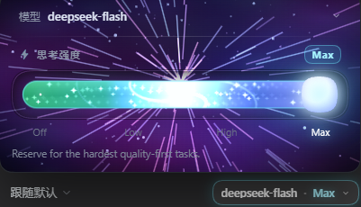
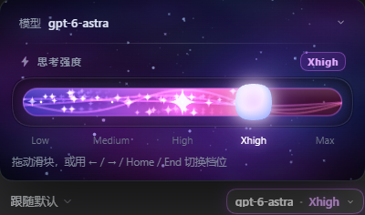

# dsh-effort-slider

A reasoning-effort slider that **replaces the shipped model selector** in the dsh
web GUI composer. One control owns both halves of the model choice: the model
list and that model's reasoning effort, which becomes a glowing rail with a
starfield behind it.

**中文**：把 dsh 输入框里的模型选择器换成一条"星光滑轨"——模型列表与思考强度由同一个控件管，切到不支持当前档位的模型时自动落到最接近的一档，不再报错。

```bash
dsh plugin add @lolannn/dsh-effort-slider          # from npm
dsh plugin add git+https://github.com/suyunxing/dsh-effort-slider   # from source
```

## Screenshots





The rail is drawn from the model's own `reasoning.efforts`, so the tick labels
change with the model — `off / low / high / max` on one, `low / medium / high /
xhigh / max` on another — and the knob lands on the level the session is
actually using.

## What it does

- Takes over `conversation.input.model` (a single slot, so this shadows the
  shipped selector rather than sitting next to it) at `priority: -1` — a single
  slot renders the **lowest** priority first.
- Reads the model catalogue at runtime: the model list comes from
  `catalog.groups` (grouped by provider) and the levels are exactly the
  `reasoning.efforts` the current model declares (typically `off / low / high /
  max`). No hard-coded list.
- Shows the Session's **real** selection, not the deployment default, by reading
  the durable `modelSelection` projection.
- Picking a level or a model calls the session `selectModel` remote with the
  explicit `{ provider, model, reasoningEffort }` triple, so the choice applies to
  the Session and is saved as the default in the background.
- Switching to a model that does not declare the level in hand is resolved on the
  client first: the closest level that model *does* declare is sent instead, and
  the status line says which substitution happened. A model with no reasoning at
  all is switched to with the field omitted, so the Host applies that model's own
  default. Nothing errors, nothing is silently dropped.
- The rail is animated: drifting particles, soft ribbon waves, iridescent
  four-point stars, a breathing star core, and a three-armed galaxy that
  collapses out of the rail at the top level. Reaching the top fires a shockwave
  burst, a star-warp starfield and a light-blade flash.
- The composer itself carries the light: a halo wraps the whole input card, with
  the same hue as the rail. Brightness, ring alpha and glow radius all follow the
  level, so `off` is a faint rim and the top level breathes; opening the panel
  lifts it. The pill only keeps an outline while the halo is on.
- The halo is a setting, not a hard rule. A `外圈光环` switch sits under the rail;
  turn it off and the glow returns to the pill alone, the way it was before the
  halo existed. The choice is stored in `localStorage` under
  `effort-slider:halo`, so it survives a reload.
- Models without reasoning efforts are tagged `无档位` in the model list and
  degrade gracefully once selected: the rail is dimmed and the status line says so
  instead of pretending to switch.

## Surfaces

| Slot | Content |
| --- | --- |
| `conversation.input.model` | the trigger (`模型 · 档位`) and, while open, the popup: model row, grouped model list, effort rail, level scale, status line |
| `conversation.input.model.label` | untouched — the shipped non-interactive label stays owner-managed |

The popup renders through `react-dom`'s `createPortal` into `document.body`,
because the composer row can live inside a transformed/overflowing ancestor that
would clip a `position: fixed` child.

## Interaction

- Click the trigger, then drag the rail or press `←` `→` `↑` `↓` `Home` `End`.
- The rail snaps to the nearest level on release (elastic overshoot).
- The level names under the rail are buttons too — same edge math as the thumb,
  so each label sits exactly under its stop.
- Click the 模型 row to expand the model list; picking a model carries the current
  effort across, remapping it when that model lacks the level (see below).
- Outside click or `Esc` closes. Direction keys are ignored while a text field
  has focus, so typing in the composer never changes the effort.

## Files

- `index.js` — Host half. The bundle row exists so the browser half has an entry
  to attach to; it declares no service, tool or config.
- `client.js` — the whole feature: stylesheet injection, catalogue + projection
  mapping, canvas engine, controller and the slot registration.
- `icon.svg` — original artwork (pinched four-point star over a lit rail).

## Notes

- All canvas work is `requestAnimationFrame`-driven and stops on unmount.
- `prefers-reduced-motion: reduce` disables the burst, the warp and the quake.
- Only transforms, `opacity` and canvas are animated; no layout thrash.
- The canvas is sized from the card (`getBoundingClientRect` + `ResizeObserver`),
  not from the viewport.
- Opening the popup while already on the top level arms the burst guard instead of
  firing it, so the celebration only plays when you actually move into the top
  level.
- The popup opens upward, but flips downward and caps its height when the trigger
  sits too low for that (landscape phone, small window).

## Why a model switch remaps the effort

The Host validates the triple, it does not normalize it. In
`@deepseek-ai/dsh-llm` → `resolveCallWithInfo`:

```js
const reasoning = info.reasoning;
const requested = defaulted.reasoningEffort;
if (reasoning === void 0) {
  if (requested !== void 0) throw new LlmError(`... does not support reasoning effort "${requested}"`, "UNSUPPORTED_REASONING_EFFORT");
} else {
  const effective = requested ?? reasoning.defaultEffort;
  if (effective !== void 0 && !reasoning.efforts.some((e) => e.id === effective)) throw new LlmError(..., "UNSUPPORTED_REASONING_EFFORT");
}
```

The comment above it is explicit: *"no clamping or aliasing is performed."* A
model with three rungs and a model with seven therefore reject each other's
levels, and the session remote wraps that rejection as
`RemoteError("session/model-unavailable", …)` — which used to surface as a red
`切换失败：provider "…" model "…" does not support reasoning effort "…"`.

So `resolveEffort(model, wantedId)` in `client.js` maps the level onto the target
model before the request is built:

| Case | What is sent | Status line |
| --- | --- | --- |
| target declares the level | it, unchanged | nothing |
| target declares other levels | the closest one | `该模型没有「medium」档，已自动切到最接近的「low」` |
| target declares no reasoning | the field is **omitted** | `「<model>」没有思考强度档位，已按模型默认运行` |

"Closest" is measured on one shared scale rather than per-provider lists, because
every adapter names its rungs from the same vocabulary:
`off · none · minimal · low · medium/med · high · xhigh · max · ultra`. A tie
resolves to the **stronger** rung — losing reasoning power is the worse of the two
surprises (`high → xhigh` rather than `high → medium` when both are one step
away). A rung whose id is not on that scale is placed by its position in its own
list, and when the id being carried is itself unknown the target's
`defaultEffort` (then its strongest rung) is used instead, because its distance
cannot be measured.

The last real choice is remembered in `lastEffort`, so
`max → 无档位模型 → back` returns to `max` instead of that model's default: the
intent survives the models that cannot express it.

## Why every visible label is passed through `safeLabel`

dsh-pocket installs a document-level click guard for phones: any click on a
`<button>`/`<a>` whose **text content** looks like a file path is cancelled with
`preventDefault()` + `stopImmediatePropagation()` and replaced by a toast
("手机上无法直接打开电脑上的文件"). Its matcher includes
`/[\w.\-]+\/[\w.\-]+\.\w{1,12}/`, which a model id like
`workbuddy-ai/deepseek-v4.1-flash` matches — so the trigger became unclickable on
mobile while working fine on the desktop.

Every label rendered as text therefore runs through `safeLabel()`, which turns
`/` and `\` into ` · `. `aria-label` and `title` keep the raw identifier, because
they are attributes and the guard only reads `textContent`.

## Where the "current" model comes from

`modelCatalog().default` is the *deployment* default and can differ from what a
Session really runs (a Session-local override). Spreading it into a commit
silently switched the model while the user only meant to change the effort.

So the controller follows the Session's durable projection — the same source the
shipped selector reads:

```js
sessions.binding(sessionId).session.projections.faceOf("modelSelection")
// -> ObservableSnapshot<{ lastUsed, next }>, next = pending ?? lastUsed
```

`model/selection` carries the user's intent immediately (`pending`), and
`request/header` records what a request actually used (`lastUsed`). Two details
matter:

- The face is subscribed **before** the first `getSnapshot()`; reading a
  projection nobody observes can return no value at all.
- The catalogue default is a fallback only, used until the projection has a value.

## Verification

- `conversation.input.model` resolves to this plugin (`priority: -1`, active) and
  the shipped registrant goes inactive.
- Trigger reads `选择模型与思考强度 — <model> · <effort>`; changing the level
  propagates through `selectModel` into the projection and back into the label.
- The popup's model list exposes every routable model, grouped per provider.
- Switching `medium` (on a seven-rung model) to an `off/low/high/max` model sends
  `low` and reports the substitution; switching to a no-reasoning model sends no
  `reasoningEffort` at all; switching back restores `medium`.
- Checked in a real client at 360×780, 360×400 (short) and 1280×800: a real click
  opens the popup, it stays inside the viewport, the level labels sit under the
  thumb stops, the selected model is marked, and opening does not replay the
  top-level burst.
